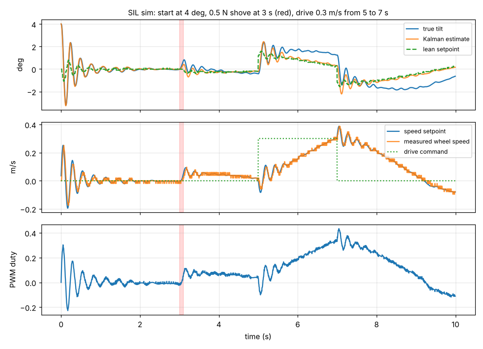

[](https://github.com/KaushikApp123/balance-bot/actions/workflows/ci.yml)

# Self-Balancing Robot (STM32F4 + FreeRTOS)

A two-wheeled robot that balances itself like an inverted pendulum. An
STM32F411 (ARM Cortex-M4F) reads an MPU-6050 IMU over I2C with DMA, estimates
the tilt angle with a Kalman filter, and runs a cascaded PID loop that drives
the motors to keep it upright. FreeRTOS splits the work into six prioritized
tasks. A custom carrier PCB ties everything together, and a Python BLE
dashboard shows live data and lets me tune the PID gains without reflashing.



*The firmware's own control code balancing a physics model: 4 deg start, a
shove at 3 s, a drive command from 5 to 7 s. See [docs/design.md](docs/design.md).*

## At a glance

| | |
|---|---|
| MCU | STM32F411CEU6 (WeAct BlackPill), 100 MHz, FPU |
| IMU | MPU-6050, **500 Hz**, I2C **400 kHz**, interrupt + DMA reads |
| Filter | 2-state Kalman (angle + gyro bias), adaptive R, 3-sigma innovation gate |
| Control | velocity **50 Hz** -> angle **200 Hz** -> wheel speed **1 kHz** |
| RTOS | FreeRTOS 11, 6 tasks: safety, motor, sensor, balance, telemetry, logger |
| Safety | motor cutoff past **40 deg**, IMU timeout, low battery, driver fault, task heartbeat, watchdog |
| Motor drivers | 2x TI DRV8874 (PH/EN, 6 A peak, current sense) |
| Motors | JGB37-520 12 V 330 rpm, Hall encoders, 1320 counts/rev |
| Power | 3S LiPo 1300 mAh, TPS563201 buck to 5 V |
| Wireless | ESP32-C3 BLE bridge, Nordic UART Service |
| Dashboard | Python, PySide6 + pyqtgraph + bleak, live plots and live gain tuning |

## Repo layout

```
firmware/
  core/        portable C: Kalman, PID, cascade, speed estimator, protocol
  app/         STM32 side: board setup, MPU-6050 driver, motors, 6 FreeRTOS tasks
  test/        host unit tests for core/
  cmake/       ARM toolchain + firmware build (fetches HAL, CMSIS, FreeRTOS)
  linker/      linker script with a flash sector reserved for saved gains
bridge/        ESP32-C3 BLE <-> UART bridge (PlatformIO, NimBLE)
host/
  balancebot/  protocol, ctypes wrapper of core/, physics model, SIL sim, dashboard
  tests/       pytest: protocol + closed-loop sim tests
hardware/      carrier PCB spec: BOM, pin map, power tree, layout rules
docs/          design notes and the reasons behind each choice
```

## Build and run

**Host tests and the sim library** (any OS with CMake and a C compiler):

```bash
cmake -S firmware -B build-host
cmake --build build-host
ctest --test-dir build-host --output-on-failure
```

**Firmware** (needs `arm-none-eabi-gcc` 12+; vendor code is fetched at configure time):

```bash
cmake -S firmware -B build -DCMAKE_TOOLCHAIN_FILE=cmake/arm-none-eabi.cmake -DCMAKE_BUILD_TYPE=Release
cmake --build build
cmake --build build --target flash      # OpenOCD + ST-Link
```

Flash the `.elf` or `.hex`, not a raw `.bin` (a `.bin` would wipe the saved-gains sector).

**BLE bridge** (ESP32-C3):

```bash
cd bridge && pio run -t upload
```

**Dashboard and sim:**

```bash
cd host
pip install -e ".[dev,plot]"
python -m balancebot.sim --plot          # closed-loop sim with the real control code
python -m balancebot.dashboard --sim     # dashboard driving the sim, no hardware needed
python -m balancebot.dashboard           # dashboard over BLE to the robot
pytest
```

In the dashboard: Arm / Disarm, edit any gain and it is sent live, Save to
flash, W/A/S/D to drive, Space to disarm, Record to CSV.

## How it works

1. **Sensing.** IMU data-ready interrupt starts a 14-byte DMA read. The DMA
   complete interrupt wakes the sensor task with a task notification. The CPU
   never waits on the bus.
2. **Kalman filter.** Gyro predicts, accelerometer corrects, and the filter
   also tracks gyro bias. Accel readings far from 1 g or far from the
   prediction are trusted less.
3. **Cascaded PID.** The angle loop outputs a wheel *acceleration* that is
   integrated into a speed setpoint (with a fast speed loop underneath, this is
   what actually holds a pendulum up). A slow velocity loop on top picks the
   lean angle so the robot stays put or drives at the commanded speed.
4. **FreeRTOS.** Fixed-period tasks use `vTaskDelayUntil`. Data moves through
   single-slot mailbox queues. Gains sit behind a mutex with priority
   inheritance. Telemetry is the lowest-priority hardware task.
5. **Safety.** The highest priority task owns the state machine and can always
   cut the motors. The watchdog is only fed if every control task is alive.
6. **Dashboard.** Gains change on the robot within 20 ms, no reflash.

Details, numbers and trade-offs: [docs/design.md](docs/design.md).
PCB: [hardware/README.md](hardware/README.md).

## Status

- Firmware builds clean with `-Wall -Wextra -Werror` (64 KB flash, 37 KB RAM).
- Control core is unit tested on the host and closed-loop tested in the SIL sim.
- The default gains come from the sim and are a starting point for tuning on
  the real robot.
- Next up: drawing the KiCad schematic and board (`hardware/kicad/`) from the
  spec in `hardware/README.md`.

## License

MIT, see [LICENSE](LICENSE). Vendor code (STM32 HAL, CMSIS, FreeRTOS) keeps its
own license and is downloaded at build time, not stored here.
