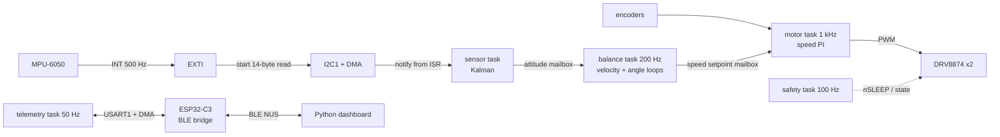

# Design notes

Why each part of the robot is built the way it is, with the numbers. Section
numbers match the order of the README summary. The last section is a list of
short answers to questions people ask about this kind of project.



---

## 1. Sensing: IMU over I2C with DMA

| Setting | Value | Why |
|---|---|---|
| IMU | InvenSense MPU-6050 (GY-521 module) | Common, data-ready pin, onboard DLPF |
| Sample rate | **500 Hz** (1 kHz internal, SMPLRT_DIV = 1) | 2.5x the 200 Hz angle loop so it always has a fresh sample |
| I2C speed | **400 kHz** (Fast mode) | One 14-byte burst takes about 0.38 ms, so the bus is about 19% busy |
| Ranges | +-4 g, +-500 dps | Balancing never comes close to either limit, and smaller ranges mean finer LSBs |
| On-chip filter | DLPF 44 Hz accel / 42 Hz gyro | Removes motor vibration before it aliases at 500 Hz |

**Why the accelerometer and gyro both matter.** The accelerometer measures
gravity, so `atan2(-a_fwd, a_up)` gives an absolute tilt. But it also measures
every bump and every time the base accelerates, so it is noisy. The gyro
measures rotation rate cleanly, but integrating it to get an angle also
integrates its bias, so the angle drifts (2 deg/s of bias is 120 deg after a
minute). The filter in section 2 uses each where it is good.

**Read path.** The MPU-6050 pulls INT high when a new sample is ready. The
EXTI interrupt starts `HAL_I2C_Mem_Read_DMA` for the 14 bytes at 0x3B (accel,
temperature, gyro). DMA moves the bytes while the CPU runs other tasks. The
DMA-complete interrupt copies the buffer and calls `vTaskNotifyGiveFromISR`,
which wakes the sensor task. No task ever waits on the bus.

Using the data-ready pin instead of a timer means every read gets a brand new
sample, never a stale or half-updated one, and the filter dt is exactly the
chip's own sample period.

**When the bus breaks.** If no sample arrives for 20 ms the sensor task
recovers the bus: it clocks SCL up to 9 times to free a slave stuck holding
SDA, sends a STOP, resets the I2C peripheral and reconfigures the IMU.
Meanwhile the safety task sees stale data and cuts the motors.

Code: `firmware/app/src/imu_mpu6050.c`, `firmware/app/src/task_sensor.c`.

---

## 2. Kalman filter

Two states: **angle** and **gyro bias**. Code: `firmware/core/src/kalman.c`.

- **Predict** with the gyro: `angle += dt * (gyro - bias)`, and grow the
  covariance P by Q.
- **Correct** with the accelerometer angle: the gain K decides how far to move
  toward it, and the same innovation also nudges the bias estimate. This is how
  the filter learns the gyro bias with no extra sensor.

| Parameter | Value | Meaning |
|---|---|---|
| Q_angle | 3e-6 rad^2/s | How much the angle can change beyond what the gyro says |
| Q_bias | 1e-6 (rad/s)^2/s | How fast the gyro bias is allowed to wander (slowly) |
| R | 1e-3 rad^2 | Accelerometer angle noise, about 1.8 deg std |

Bigger Q means "trust the model less, follow the accelerometer more". Bigger R
means "the accelerometer is noisy, lean on the gyro". With these values the
accelerometer pulls the estimate in with a time constant of roughly half a
second: short events ride on the gyro, long-term drift is removed.

**Two additions on top of the textbook filter:**

1. *Adaptive R.* If the total acceleration is more than 5% away from 1 g, the
   accelerometer is seeing more than gravity, so R is scaled up (up to 100x).
2. *Innovation gate.* If the accelerometer angle is more than 3 sigma away from
   the prediction, R is inflated just enough to put it at 3 sigma. One bad
   reading can only move the estimate a bounded amount.

**Measured on the host tests** (`firmware/test/test_core.c`, synthetic data):

- Gyro bias 2.00 deg/s, estimated 1.99 deg/s; angle error after settling 0.18 deg
- 200 ms of 0.3 g sideways shove: raw accel angle reads 16.7 deg, the filter
  moves only 2.3 deg

**Why not a complementary filter?** Honestly, a complementary filter
(`angle = 0.98 * (angle + gyro*dt) + 0.02 * acc_angle`) is simpler and is
often good enough for a balancing robot. I picked the Kalman filter because it
also estimates the gyro bias and removes it, its gain comes from noise
numbers I can reason about instead of a magic 0.98, and it gave me a clean
place to add the adaptive R and gating. The cost is a few more lines and 4
covariance terms, which is nothing on a Cortex-M4F with an FPU.

Initial bias comes from a 1 s average at boot with the robot held still
(`imu_calibrate`). The filter refines it from there.

---

## 3. Cascaded PID

Three loops, slowest on the outside. Code: `firmware/core/src/controller.c`.

| Loop | Rate | Input | Output |
|---|---|---|---|
| Velocity | **50 Hz** | commanded speed minus wheel speed | lean angle setpoint (max 10 deg) |
| Angle | **200 Hz** | tilt minus lean setpoint, D from the gyro | wheel acceleration, integrated into a speed setpoint |
| Wheel speed | **1 kHz** (5x the angle loop) | speed setpoint minus encoder speed | motor volts, divided by battery volts to get PWM duty |

**Why the angle loop outputs acceleration and not speed.** This was the one
real surprise. For an inverted pendulum, what pushes the body back upright is
the base *accelerating* under it:

```
theta'' = (g / L) * theta - a / L
```

If the angle loop output went straight to a speed setpoint and the inner loop
tracked it, then `a = d/dt (Kp*theta + Kd*theta') = Kp*theta' + Kd*theta''`.
Put that in and the stiffness term `(g/L) * theta` has nothing to cancel it,
so the robot falls, just slowly. Integrating the angle loop output (accel ->
speed) gives `a = Kp*theta + Kd*theta'`, which works as long as `Kp > g`.
In code that is one line: `v_sp += accel_cmd * dt`.

**Why the velocity loop exists.** With only the angle loop, the robot balances
but rolls away, because a tiny lean offset looks like "upright" to it. The
velocity loop asks for a small lean to make the measured speed match the
command (zero when parked). To stop, the robot first has to lean back, and to
lean back the wheels first roll forward a little. That is normal for this kind
of system and is why the velocity loop must stay slow.

**Wheel speed measurement.** At 1 kHz a wheel at full speed moves about 7
encoder counts per sample, too coarse to difference sample to sample. The
estimator differences over an 8-sample window (8 ms): 1 count of resolution
is about 2 cm/s, at the cost of about 4 ms of lag.

**Inner loop feedforward and battery compensation.** The speed loop adds
`v_sp / 0.0937` volts of feedforward (the motor's speed per volt from its
datasheet) so the PI only fixes the error. It works in volts and divides by
the measured battery voltage, so the loop gain does not drop as the pack goes
from 12.6 V to 10 V.

### Gains

Starting values come from the software-in-the-loop sim (section 8):

| Loop | Kp | Ki | Kd |
|---|---|---|---|
| Angle | 100 (m/s^2)/rad | 0 | 2.0 (m/s^2)/(rad/s) |
| Wheel speed | 8 V/(m/s) | 100 V/m | 0 |
| Velocity | 0.08 rad/(m/s) | 0.02 rad/m | 0 |

**How I tune (on the sim, then the robot, from the dashboard):**

1. Inner loop first, wheels off the ground. Raise speed Kp until the wheel
   tracks a step without ringing, then add Ki to remove the steady error.
2. Angle loop with velocity gains at zero. Raise Kp until it holds itself up
   but oscillates, then add Kd until the oscillation damps out. Back Kp off a
   little.
3. Velocity loop last, small Kp until it stops wandering, then a little Ki to
   remove the parked lean offset. Too much Kp here makes a slow, growing rock.
4. Save to flash from the dashboard when it is good.

### Integral windup

Four layers:

1. The integrator is clamped (`i_limit` per loop).
2. Conditional integration: if the output is saturated and the error would
   push it further, the integrator does not update this cycle.
3. The integrator is stored in output units (`integ += Ki * err * dt`), so
   changing Ki live from the dashboard does not make the output jump.
4. Every loop resets on the edge into ARMED, so nothing wound up while the
   robot lay on its side carries over. The speed setpoint integrator is
   clamped to 0.9 m/s.

The angle loop has no I term on purpose. The velocity loop's I does that job
(it finds the lean that keeps the robot parked), and an I in the angle loop
fights it.

Other details: D on measurement (no kick when the setpoint jumps), D from the
gyro rate (never differentiate a noisy angle), and a first-order low-pass on D.

---

## 4. FreeRTOS: six tasks

| Prio | Task | Rate | Trigger | Job |
|---|---|---|---|---|
| 6 | safety | 100 Hz | `vTaskDelayUntil` | Fault checks, state machine, motor cutoff, watchdog |
| 5 | motor | 1 kHz | `vTaskDelayUntil` | Encoders to speed, speed PI, PWM out |
| 4 | sensor | 500 Hz | notification from the DMA ISR | Kalman filter, publish attitude |
| 3 | balance | 200 Hz | `vTaskDelayUntil` | Velocity and angle loops, publish speed setpoint |
| 2 | telemetry | 50 Hz | `vTaskDelayUntil` | Frames to the BLE bridge, parse commands |
| 1 | logger | 10 Hz | `vTaskDelayUntil` | Debug UART stats, LED |

Priorities are rate monotonic (faster loop, higher priority), with safety above
everything because it must always be able to cut the motors. The 1 kHz FreeRTOS
tick is the motor loop period.

**vTaskDelayUntil, not vTaskDelay.** `vTaskDelay(5)` sleeps 5 ticks from *now*,
so the period becomes 5 ms plus however long the loop body took plus any
preemption, and it drifts. `vTaskDelayUntil(&last, 5)` wakes at `last + 5`, a
fixed grid, so the period stays 5 ms. The PID math assumes a constant dt, so
this matters. The balance task measures its own wake-up jitter with the DWT
cycle counter and the logger prints the worst case.

**ISR to task notifications.** The DMA-complete ISR wakes the sensor task with
`vTaskNotifyGiveFromISR`. A task notification is a counter built into the task
itself, so there is no semaphore or queue object to create, and it is faster.
The count also tells the task if it ever missed a sample. All ISRs that use
FromISR calls run at NVIC priority 5 or lower urgency
(`configMAX_SYSCALL_INTERRUPT_PRIORITY`).

**Sharing data.** Latest-value data (attitude, wheel speeds, setpoints) goes
through length-1 queues used as mailboxes: `xQueueOverwrite` to publish,
`xQueuePeek` to read. Readers never block and always get a whole struct, never
half old and half new.

**Priority inversion.** The gains are written by the telemetry task (priority 2)
and read by the motor task (priority 5). If telemetry held a plain semaphore
and the balance task (priority 3) preempted it, the motor task would be stuck
waiting behind a lower priority task. The gains sit behind a FreeRTOS *mutex*,
which has priority inheritance: while telemetry holds it and the motor task
wants it, telemetry runs at priority 5 until it lets go. The critical section is
a struct copy, a few microseconds. The motor task also only refreshes its
copy at 100 Hz to keep the lock rare.

**Why telemetry is low priority.** If the CPU is ever short on time, a dropped
telemetry frame costs nothing and a late control cycle can drop the robot. The
BLE side is also the least predictable part of the system (connection
intervals, retries), so it must never be able to delay control.

**What the safety task does:**

| Fault | Condition |
|---|---|
| TILT | \|angle\| > **40 deg**. It has fallen; spinning the wheels only makes it worse |
| IMU | no new sample for 20 ms (10 missed samples) |
| BATT | pack below 9.9 V (3.3 V/cell) for 1 s |
| DRIVER | either DRV8874 pulls nFAULT low (overcurrent, overtemp, undervoltage) |
| TASK | sensor, balance or motor task stopped running for 50 ms |

On any fault while armed: PWM to zero, drivers put to sleep (outputs go high
impedance so the wheels coast), state latches to FAULT until a disarm. Arming
is only allowed within 5 deg of upright and with no active faults. The
independent watchdog (about 1 s) is only kicked when all three control tasks
have checked in, so a hung task resets the MCU even if the safety task itself
still runs.

---

## 5. KiCad carrier PCB

Full spec, pin map and layout rules: [`hardware/README.md`](../hardware/README.md).

- Motor drivers: 2x TI **DRV8874** (PH/EN, 6 A peak, current sense, nFAULT)
- BLE: **ESP32-C3-MINI-1**
- Power: **3S LiPo 1300 mAh**, XT30, PTC fuse, P-FET reverse protection,
  TPS563201 buck to 5 V, separate LDO for the radio
- Decoupling: 100 nF at every supply pin plus bulk per rail, 220 uF + 10 uF +
  100 nF on motor power right at the drivers
- Grounding: power half and logic half of the board, one solid ground pour,
  motor return currents meet logic ground only at the battery terminal
- Rev 2: IMU (ICM-42688-P) on the board near the axle, current loop using
  IPROPI, MCU on the board with USB-C, 4 layers

---

## 6. Python BLE dashboard

Code: `host/balancebot/dashboard/`. PySide6 + pyqtgraph + bleak.

- The ESP32-C3 runs the **Nordic UART Service**: one notify characteristic
  (robot to PC) and one write characteristic (PC to robot). It forwards bytes
  both ways without parsing them, so the protocol is defined only in
  `protocol.c` and `protocol.py`.
- Frames: `AA 55 | type | len | payload | CRC-16`. Sync bytes and a CRC mean
  BLE packet boundaries do not matter and a corrupted frame is just dropped.
- Telemetry at 50 Hz: tilt, setpoint, P/I/D terms, speed setpoint, both wheel
  speeds and duties, battery, state, fault bits.
- Writing Kp, Ki, Kd for any loop applies on the robot within one telemetry
  cycle (20 ms). "Send while editing" pushes changes as you scroll a value.
  Gains can be read back and saved to flash.
- W/A/S/D drives, Space disarms, Record writes a CSV of all telemetry.
- `--sim` runs the same dashboard against the sim with the same byte protocol.

**Why it matters.** A reflash cycle is build, flash, unplug, set the robot
down, re-arm: on the order of a minute, and every attempt starts from scratch.
Live gains take effect in under a tenth of a second, while the robot is
balancing, so I can watch the plot change as I turn a value.

---

## 7. Flash storage

Saved gains live in flash sector 1 (16 KB at 0x08004000), which the linker
script keeps empty. The vector table lives in sector 0 and the program starts
at sector 2. A 16 KB sector erases in about 0.25 s, versus about 1 s for the
128 KB sectors, which stays well inside the 1 s watchdog. Saving is refused
while armed because the erase stalls the CPU. The build does not produce a raw
`.bin` on purpose: flashing one would overwrite sector 1. Flash the `.elf` or
`.hex`.

---

## 8. Software-in-the-loop sim

`host/balancebot/sim.py` loads the firmware control core (`libbbcore`, the
same `kalman.c`, `pid.c`, `controller.c` and `speed_est.c` that run on the
STM32) through ctypes and closes the loop around a physics model of the robot
(`model.py`): wheeled inverted pendulum, DC motor with back-EMF and friction,
encoder quantization, IMU noise and a 1.5 deg/s gyro bias. Task rates match
the firmware: physics 10 kHz, motor loop 1 kHz, IMU 500 Hz, balance 200 Hz.

Default scenario: start at 4 deg, a 0.5 N shove for 100 ms at t = 3 s, drive
at 0.3 m/s from 5 to 7 s.


Results: stays up the whole run, worst tilt 4 deg (the start), Kalman error
under 1.2 deg, peak PWM 43%. The gains also hold with the COM height changed
from 9 cm to 6 or 13 cm, 45% more mass, and a 10 V pack (`tests/test_sim.py`).

What the sim does not show: motor deadband, backlash, wheel slip, a flexible
chassis and real sensor noise spectra. It gets the signs, the structure and the
starting gains right. Final tuning still happens on the robot.

---

## 9. Short answers

**Why DMA for the IMU?** The burst takes 0.38 ms, 500 times a second. Polling
would burn about 19% of the CPU waiting on the bus.

**Why 500 Hz?** It is 2.5x the angle loop, so the loop always sees a sample
under 2 ms old, and it leaves the bus 80% idle.

**Why is the inner loop 5x faster than the outer?** The outer loop treats the
inner one as "instant". If the inner loop settles 5 to 10 times faster, that is
close enough to true, and the two loops do not fight.

**How did you handle windup?** Clamp, conditional integration, integrator in
output units, reset on arm. No I in the angle loop.

**What happens if BLE drops?** Nothing for balance. Telemetry is the lowest
priority hardware task, drive commands time out after 500 ms and the robot
parks itself.

**What if a task hangs?** The safety task sees its heartbeat stop within 50 ms
and cuts the motors. If the safety task itself hangs, the watchdog resets the
MCU within about a second, and the drivers start asleep after reset.

**What is the worst thing about this design?** The accelerometer cannot tell
tilt from linear acceleration. The filter gates and down-weights it, but during
a long steady acceleration the estimate still drifts a fraction of a degree.
The velocity loop absorbs it. A wheel-odometry based correction would fix it.

**What would you do next?** Current loop with IPROPI, the ICM-42688-P on the
board, and a position loop on top so it holds a spot instead of a speed.
